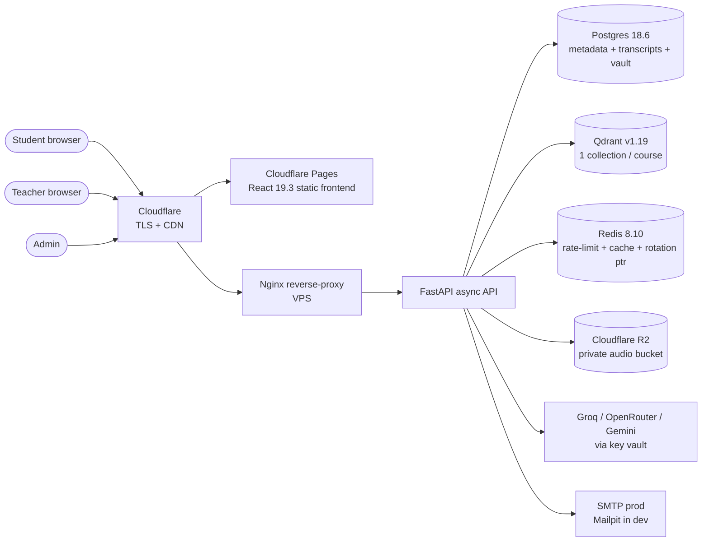

# Majlis — Architecture, Structure & ERD

Companion to `.scratch/majlis-v1/spec.md`, `CONTEXT.md`, and `docs/adr/`. Ticket 01 builds from this file.

## 1. Container architecture



Rules: browsers never touch R2/Postgres/Qdrant directly — every byte goes through presigned URLs (uploads) or signed playback URLs (streaming) after API membership checks. The VPS never stores media bytes.

## 2. Docker Compose topology (ticket 01)

Services: `api`, `postgres`, `qdrant`, `redis`, `reverse-proxy`, plus `mailpit` as dev SMTP. No worker service (ADR-0001). Volumes only for database data; media lives in R2. Single private R2 bucket, prefix `courses/{course_id}/lessons/{lesson_id}/`.

## 3. Backend structure (per fastapi-templates skill)

```
backend/
├── app/
│   ├── api/v1/endpoints/
│   │   ├── auth.py          # signup/verify/login/refresh/reset + me
│   │   ├── users.py         # admin: teacher invites, bans
│   │   ├── courses.py       # series CRUD (optional single book, kind fixed at creation)
│   │   ├── lessons.py       # lesson CRUD + transcript textareas + audio refs
│   │   ├── enrollment.py    # codes generate/trace/revoke + join + approve/reject/block
│   │   ├── uploads.py       # presigned PUT issue + confirm/verify + playback URLs
│   │   ├── exams.py         # exam + question bank CRUD (authoring)
│   │   ├── attempts.py      # take/submit/auto-grade
│   │   ├── grades.py        # essay grading + gradebook + CSV
│   │   ├── keys.py          # admin vault CRUD + usage log
│   │   └── chat.py          # per-course chat over RAG core
│   ├── core/                # config, security (JWT/Fernet), database, rate-limit
│   ├── models/              # SQLAlchemy models (one module per aggregate)
│   ├── schemas/             # Pydantic request/response per endpoint
│   ├── services/            # business logic (enrollment transitions, grading, rotation, RAG)
│   ├── repositories/        # data access per aggregate
│   └── main.py              # app entry, lifespan, middleware, router
├── tests/                   # behavior tests per seam (fakes at R2/LLM boundary)
├── alembic/                 # migrations
└── pyproject.toml           # uv + ruff config
```

## 4. Frontend structure (React 19.3 + bun, Cloudflare Pages)

```
frontend/
├── src/
│   ├── pages/               # login/signup/verify, student dashboard, teacher dashboard, admin
│   ├── features/            # auth, courses, lessons (audio player), enrollment, exams, grades, chat
│   ├── components/          # shared RTL UI primitives
│   └── api/                 # typed client for the v1 endpoints
└── …                        # bun project files
```

Arabic-first RTL throughout, responsive down to phone sizes, no native app in V1.

## 5. ERD (Postgres; Qdrant collections mirror lesson transcripts)

```mermaid
erDiagram
    users ||--o{ teacher_invites : creates
    users ||--o{ courses : teaches
    users ||--o{ enrollments : holds
    users ||--o{ attempts : sits
    users ||--o{ llm_api_keys : manages
    courses ||--o{ lessons : contains
    courses ||--o{ course_attachments : has
    lessons ||--o{ lesson_attachments : has
    courses ||--o{ enrollment_codes : issued_for
    courses ||--o{ exams : assessed_by
    courses ||--o{ enrollments : has
    lessons ||--o{ exams : scoped_to
    courses {
        uuid id PK
        text title
        text description_NULL
        text book_title_NULL
    }
    course_attachments {
        uuid id PK
        uuid course_id FK
        text title
        text file_key_NULL
        bool is_main_book
    }
    lesson_attachments {
        uuid id PK
        uuid lesson_id FK
        text title
        text file_key_NULL
    }
    lessons {
        uuid id PK
        uuid course_id FK
        text title
        text description_NULL
        date lesson_date
        int pages_from_NULL
        int pages_to_NULL
        text audio_ref
        text media_type
        text transcript_voice
        text transcript_book
        text status
    }
    enrollment_codes {
        uuid id PK
        uuid course_id FK
        text code
        timestamptz expires_at
        int max_uses
        int uses
        bool revoked
    }
    enrollments {
        uuid id PK
        uuid user_id FK
        uuid course_id FK
        text status
    }
    exams {
        uuid id PK
        uuid course_id FK
        uuid lesson_id FK_NULL
        int attempts_allowed
        int duration_min
        timestamptz open_at
        timestamptz close_at
        text show_result_mode
    }
    exams ||--o{ questions : has
    questions {
        uuid id PK
        uuid exam_id FK
        text qtype
        jsonb options
        text correct
        int max_score
    }
    attempts {
        uuid id PK
        uuid exam_id FK
        uuid user_id FK
        int score
        bool published
    }
    attempts ||--o{ attempt_answers : contains
    llm_api_keys {
        uuid id PK
        text provider
        text model
        text encrypted_key
        bool is_active
        timestamptz last_used_at
    }
    llm_api_keys ||--o{ llm_usage_log : produces
```

Status enums: `enrollments.status` = pending/approved/rejected/blocked; `lessons.status` = processing/ready/failed; `show_result_mode` = immediate/after-publish. Gradebook is a read projection over attempts, not a table. RAG chunks live in Qdrant (metadata: lesson_id, course_id, pages, source_type voice|book), not Postgres.

## 6. Key flows

- **Upload:** API presigned PUT → browser → R2 → client confirm → API verify → lesson ready (retry = fresh URL).
- **Enroll:** code → pending → teacher approve/reject/block.
- **Exam:** author (07) → take + auto-grade (08) → manual grade + publish (09).
- **RAG:** Postgres transcripts → indexed chunks (11, CLI-gated) → chat UI with citations + quota (12).
